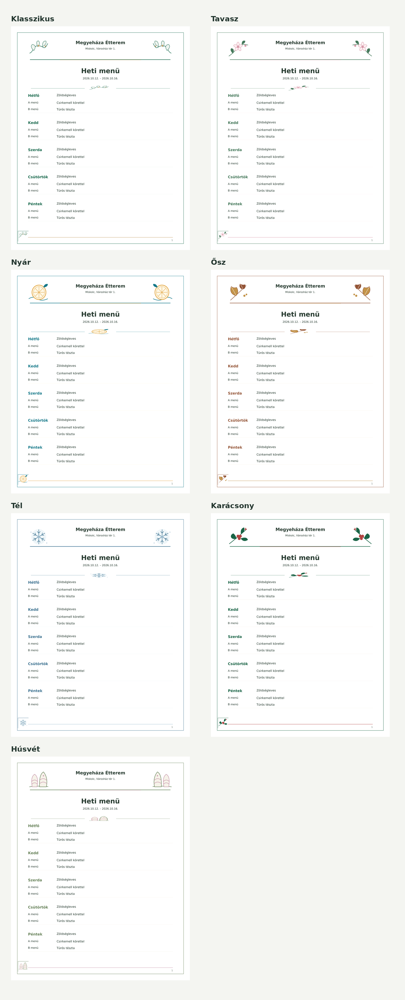

# ÉtlapStúdió

Windowsra szánt, helyi adatbázissal működő **Qt6 asztali étlapszerkesztő**. A bal oldali, összecsukható sávban a korábbi étlapok hetek szerint csoportosítva láthatók. Középen három egyszerű fül van, jobb oldalon pedig folyamatosan frissül a készülő étlap előnézete. A mentés és a két exportgomb közvetlenül az előnézet fölött található.



## Funkciók

- **Napi étlap:** az új nap az előző olyan nap választásából indul, amelyen már volt étel. A kompakt kategóriagombok mindig láthatók; az ételrács az ablak szélességéhez igazodik, és kizárólag függőlegesen görgethető. Az ételre kattintva felugró ablakban lehet felvenni vagy kivenni, a normál és akciós árat pedig egyszerűen be lehet írni. A Mentés a normál árat, a napi kiválasztást és az akciót együtt, azonnal rögzíti. A napi leves és az A/B menü a heti szerkesztőből kerül a felső blokkba.
- **Akciók:** az étel felugró ablakában az akció jelölőnégyzete bekapcsolja az akciós ár mezőjét. Az árnak a normál árnál kisebbnek kell lennie. Az akció csak az adott napra vonatkozik. Az étlapon az eredeti ár áthúzva, az új ár pirossal és **AKCIÓ** felirattal látszik.
- **Heti menü:** hétfőtől péntekig önálló leves, A és B menü. A mezők gépelés közben javaslatokat adnak a külön **Menü** kategóriából; szabadon új fogás is beírható. A Menü kategória tételei nem jelennek meg a napi à la carte pipálható listában.
- **Ételadatbázis:** 341 induló tétel a feltöltött 2026. július–októberi étlapképek alapján, kategóriák, árak, keresés, felvétel, szerkesztés, törlés. Új adatbázisba automatikusan betöltődik. Meglévő adatbázisban az **Ételek → Alapadatbázis hiányzó ételeinek betöltése** gomb egészíti ki; ez nem írja felül a saját neveket, árakat vagy törölt tételeket.
- **Korábbi étlapok:** kattints egy napra vagy hétre az előnézethez; dupla kattintással szerkesztésre nyitható meg. A lista hetek szerint csoportosított.
- **Dizájn:** a választott téma együtt állítja a színpalettát és a háttérképet; a tavasz és a húsvét, illetve a tél és a karácsony külön grafikát kap. Az egyszerű, színes kategóriafejlécek és az áttetsző üveghatású panelek segítik az olvashatóságot. A betűválasztók a Windowsra telepített betűket listázzák. Az alapértelmezett címbetű Georgia, a szövegbetű Segoe UI. A **Dizájn visszaállítása alapértékre** gomb a betűket, színeket és térközöket is visszaállítja.
- **Export:** 1440 × 1800 képpontos, 4:5 arányú Facebook PNG és margó nélküli A4 PDF. A napi étlap egy képen marad; az à la carte rész szükség esetén kisebb betűvel tördelődik. A **Térközök állítása** kapcsoló egyszerű, húzható vízszintes vonalakat mutat; ezek a blokkok közötti térközt állítják, a tartalmat nem nagyítják vagy nyújtják.
- **Étlapfejléc:** bal oldalon, balra igazítva jelenik meg a napi vagy heti cím és a dátum; jobb oldalon az egyedi éttermi embléma, az étterem neve, címe és telefonszáma kap helyet.

## Indítás Windows alatt

1. Telepítsd a [Python 3](https://www.python.org/downloads/) 3.10-es vagy újabb verzióját a `py` launcherrel, ha nincs a gépen.
2. Töltsd le a repót ZIP-ként, csomagold ki egy írható mappába, és indítsd az `Inditas_Windows.bat` fájlt.
3. Az első indítás helyi `.venv` környezetet készít és telepíti a `requirements.txt` csomagjait. A következő indításokhoz használd ugyanezt a `.bat` fájlt.

Python nélküli használathoz a **Build Windows app** GitHub Actions munkafolyamat `EtlapStudio-Windows` artifactot készít. A csomagot ki kell bontani, majd `EtlapStudio.exe` indítható.

### Fejlesztői indítás

```bash
python -m venv .venv
# Windows: .venv\Scripts\activate
# Linux/macOS: source .venv/bin/activate
pip install -r requirements.txt
python qt_app.pyw
```

## Használat

1. A **Dizájn** fülön add meg az étterem nevét, címét és telefonszámát.
2. A **Heti** fülön írd be hétfőtől péntekig a leveseket és az A/B menüket.
3. A **Napi** fülön állítsd be a dátumot. A már használt étlapról indul; a kategóriagombokkal vagy keresővel válassz ételeket. Kattints a fogásra, majd a felugró ablakban add meg a kívánt árat és akciót.
4. A **Dizájn** fülön válassz évszakot, betűtípust, színeket és háttér-erősséget.
5. Kattints az előnézet fölötti **Mentés**, **PDF** vagy **Facebook-kép** gombra. A korábbi étlapot a bal oldali hetes listából nyithatod meg. A „Szerkesztővonalak” bekapcsolása után a szaggatott keretekkel mozgathatod, a jobb alsó fogantyúval méretezheted a fő blokkokat.

Az adatbázis Windows alatt a `Dokumentumok\EtlapStudio\etlapstudio.sqlite3` fájlban van. Az importált témacsomagok a `themes` almappába kerülnek. A biztonsági másolat az adatbázist menti; a témacsomagokat is másold le, ha új gépre költözöl. A régi napi választások és heti menük első indításkor mentett bejegyzéssé is válnak.

A telepített rendszerfontok megjelennek a választókban. Egy font tényleges PDF-megjelenése a font és a Qt PDF motorjának támogatásától függ; a végleges exportot a PDF-ben is érdemes ellenőrizni. A választott saját betűtípus másik gépen csak akkor lesz ugyanolyan, ha azon is telepítve van.

## A feltöltött étlapokból készült alapadatbázis

A szerkeszthető [CSV fájl](data/alap_eteladatbazis.csv) 226 à la carte és 115 Menü kategóriájú tételt tartalmaz. A Menü kategóriában az üres ármező azt jelenti, hogy a fogáshoz nem volt külön ár: a korábbi lapokon látható **2800 Ft a levesből és főételből álló napi menü csomagára**, így ezt nem rendeltük hozzá egyik összetevőhöz sem. Az à la carte árak a legutóbbi jól olvasható **nem akciós** árak; a bizonytalan árakat üresen hagytuk, ezek az alkalmazásban „—” jellel szerepelnek. A CSV `megjegyzes` oszlopa jelzi a hiányzó árakat. A névírás OCR utáni kézi javítást és egységesítést kapott; a betöltött alapadatokat használat előtt érdemes az aktuális kínálathoz igazítani.

A menüfogások akkor is önálló Menü rekordok, ha ugyanaz az étel az à la carte kínálatban szerepel. Az első indítás adatbázisba másolja a CSV-t; későbbi CSV frissítésnél a gomb csak a hiányzó neveket veszi fel, meglévő árakat nem módosít. A korábban elmentett napi és heti étlapok tartalma változatlan.

## Saját grafikák

Az automatikus évszakos képek a `design_assets/` mappában vannak. A `megyehaza_emblem.png` egyedi embléma az étterem fejlécéhez és az alkalmazás ikonjához. A `spring_generic_background.jpg` általános tavaszi tájat, a `winter_generic_background.jpg` karácsonyi díszítés nélküli téli tájat mutat; a húsvéti és karácsonyi témák ezektől külön képet használnak. Új grafikát kérő AI prompt és a pontos importméretek: [GRAPHICS_PROMPT.md](GRAPHICS_PROMPT.md) és [TEMACSOMAG_FORMATUM.md](TEMACSOMAG_FORMATUM.md). A **Dizájn → Témacsomag importálása…** átlátszó hátterű PNG díszítőelemekből és színpalettából álló ZIP-et fogad. Az app nem hív automatikusan AI szolgáltatást.

## Projekt

| Fájl | Szerep |
| --- | --- |
| `qt_app.pyw` | Qt6 szerkesztő és élő előnézet |
| `menu_core.py` | SQLite adatbázis, napi akciók, mentett étlapok |
| `data/alap_eteladatbazis.csv` | A felismert ételnevek és legutóbbi olvasható normál árak |
| `catalog_seed.py` | A CSV betöltése új vagy meglévő adatbázisba |
| `menu_render.py` | Közös Qt előnézet, A4 PDF és Facebook PNG rajzolás |
| `themes.py` | PNG témacsomagok ellenőrzése és importja |
| `design_assets/`, `backgrounds/` | Szezonális képek és háttérgrafikák |
| `Inditas_Windows.bat` | Windows indítás és függőségek telepítése |
| `.github/workflows/windows-build.yml` | Windows futtatható csomag |

A GUI a **PyQt6** kötést használja, amely GPLv3 vagy kereskedelmi licenccel érhető el. Saját terjesztés előtt a választott licencfeltételeket ellenőrizni kell. Az alkalmazás helyi, nem tölt fel étlapot vagy adatot automatikusan.
